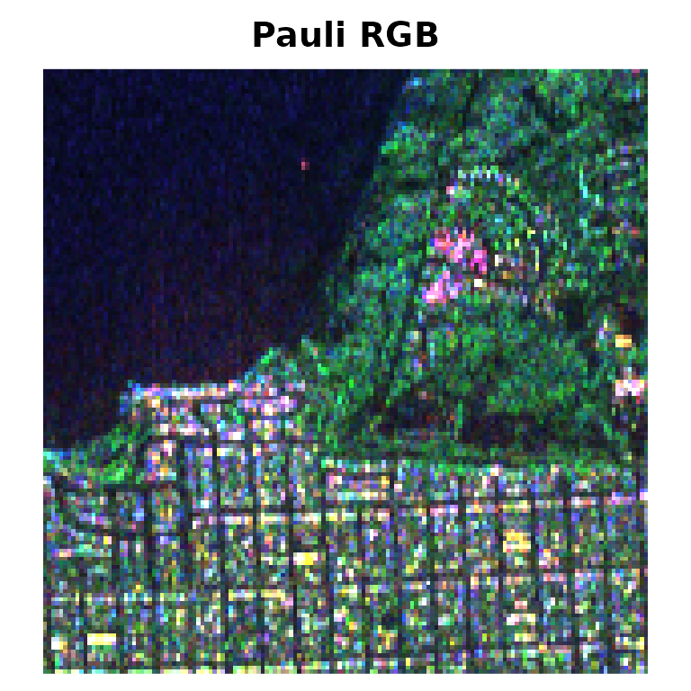
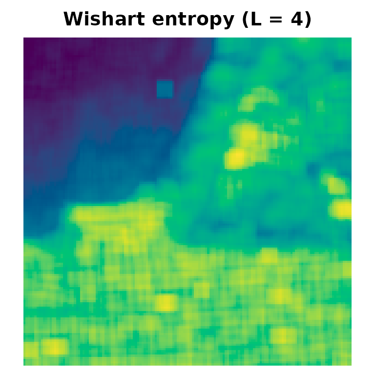
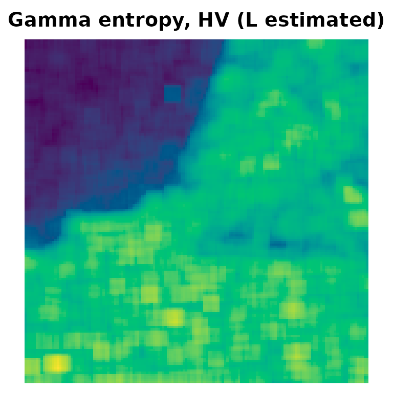
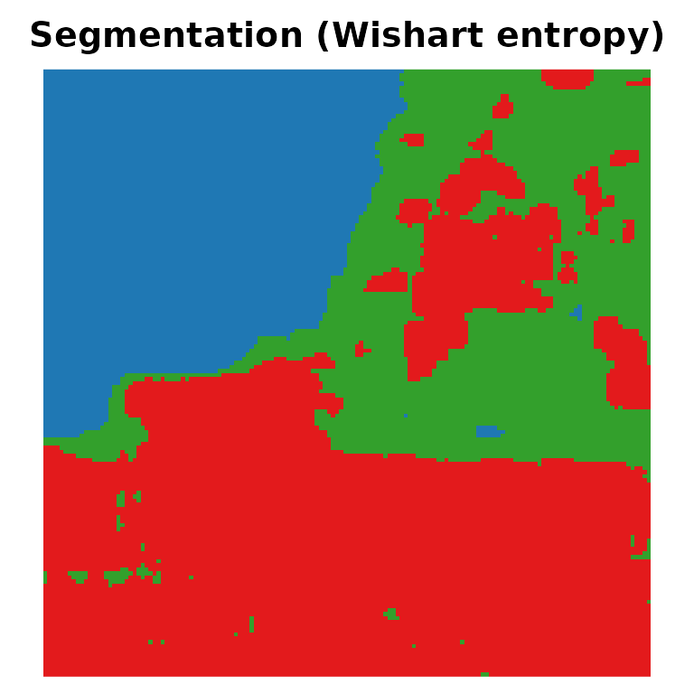
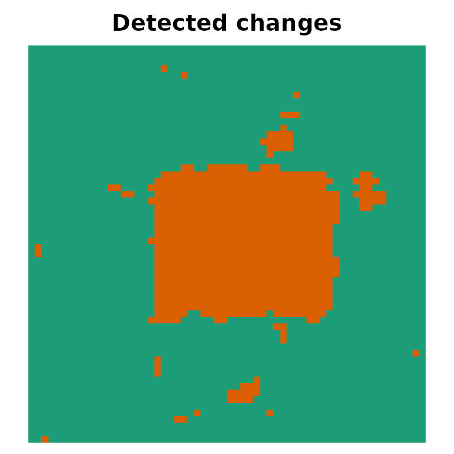

# Getting started with SITSAR

`SITSAR` gathers statistical and information-theoretic tools for
Synthetic Aperture Radar (SAR) and polarimetric SAR (PolSAR) data. This
vignette walks through the main building blocks: distributions, R6
models, Shannon entropies, image tools, segmentation and change
detection.

``` r

library(SITSAR)
```

## 1. Distributions

Intensity models (`gamma`, `G0I`, generalized gamma) follow the usual
`d/p/q/r` convention:

``` r

set.seed(1)
z <- rg0i(5, alpha = -3, gamma = 2, L = 4)
dg0i(z, alpha = -3, gamma = 2, L = 4)
#> [1] 0.8544422 0.4519509 0.5959714 0.3471399 0.7509855
pg0i(1, alpha = -3, gamma = 2, L = 4)
#> [1] 0.6803841
qg0i(0.5, alpha = -3, gamma = 2, L = 4)
#> [1] 0.6865009
```

Matrix models for PolSAR data work with Hermitian matrices, stored
either as `m x m x n` complex arrays or as `n x m(m+1)/2` “vec”
matrices:

``` r

Sigma <- polsar_example_sigma("forest")
Z <- rwishart_sar(3, Sigma, L = 4)
dwishart_sar(Z, Sigma, L = 4, log = TRUE)
#> [1] 13.45325 14.05683 10.33905
dg0p(Z, alpha = -3, Sigma = Sigma, L = 4, log = TRUE)
#> [1] 13.076392 13.297172  9.479703
dctpcw(Z, lambda = 1.5, Sigma = Sigma, L = 4, log = TRUE)
#> [1] 2.696874 4.281135 4.466185
```

## 2. R6 models: estimation, entropy and its variance

Each model is an R6 class with the methods `$fit()`, `$density()`,
`$random()`, `$entropy()` and `$entropy_variance()`:

``` r

set.seed(2)
x <- rg0i(800, alpha = -3, gamma = 2, L = 4)
m <- G0I$new()$fit(x)          # alpha, gamma and L estimated
m
#> <G0I> fitted to n = 800 observations
#>   alpha = -3.10589
#>   gamma = 1.9759
#>   L = 4.15959
#>   logLik = -634.984
#>   Shannon entropy = 0.79373
m$entropy_variance()
#> [1] 0.001645796
generics::tidy(m)
#> # A tibble: 3 × 4
#>   term  estimate std.error fixed
#>   <chr>    <dbl>     <dbl> <lgl>
#> 1 alpha    -3.11     0.350 FALSE
#> 2 gamma     1.98     0.289 FALSE
#> 3 L         4.16     0.615 FALSE
generics::glance(m)
#> # A tibble: 1 × 7
#>   model     n logLik   AIC   BIC entropy converged
#>   <chr> <int>  <dbl> <dbl> <dbl>   <dbl> <lgl>    
#> 1 G0I     800  -635. 1276. 1290.   0.794 TRUE
```

The closed-form Shannon entropies are also available as functions:

``` r

entropy_g0i(alpha = -3, gamma = 2, L = 4)
#> [1] 0.8625083
entropy_wishart(Sigma, L = 4)
#> [1] -12.04464
entropy_g0p(alpha = -3, Sigma = Sigma, L = 4)
#> [1] -13.2626
```

The compound truncated Poisson and compound geometric complex Wishart
laws are fitted by the EM algorithm:

``` r

set.seed(3)
S <- rctpcw(300, lambda = 2, Sigma = Sigma, L = 4)
cw <- CompoundWishart$new("poisson")$fit(S, L = 4)
cw$params$lambda
#> [1] 1.974606
cw$iterations
#> [1] 53
```

## 3. Images

The `SanFrancisco150` dataset is a 150 x 150 crop of an L-band AIRSAR
image, with the ground truth `SanFrancisco150_gt` (ocean, vegetation and
urban).

``` r

img <- SARImage$new(SanFrancisco150, looks = 4)
img
#> <SARImage> 150 x 150 PolSAR (3 x 3 covariance)
#>   channels: HH, HV, VV
#>   looks: 4
#>   mean HH  = 0.1735
#>   mean HV  = 0.04224
#>   mean VV  = 0.147
img$plot()
plot_map(SanFrancisco150_gt, main = "Ground truth",
         palette = c("#1f78b4", "#33a02c", "#e31a1c"))
```



## 4. Entropy maps

[`entropy_map()`](https://jodavid.github.io/SITSAR/reference/entropy_map.md)
estimates the model in a moving window centred at each pixel and returns
the map of Shannon entropies. The Gamma and Wishart maps are fully
vectorised:

``` r

Hw <- entropy_map(img, model = "wishart", window = 7, L = 4)
plot_map(Hw, main = "Wishart entropy (L = 4)")
Hhv <- entropy_map(img, model = "gamma", window = 7, channels = "HV")
plot_map(Hhv, main = "Gamma entropy, HV (L estimated)")
```



## 5. Entropy-based segmentation

Entropies are asymptotically Gaussian, so the entropy map is segmented
with a Gaussian mixture fitted by EM (or stochastic EM):

``` r

set.seed(4)
seg <- EntropySegmenter$new(k = 3, method = "em")$fit(Hw)
seg
#> <EntropySegmenter> k = 3 | method: EM 
#>   iterations: 20 | converged: TRUE 
#>   weights: 0.265 0.268 0.467 
#>   class sizes: 5933 5773 10794
plot_map(seg$label_map(), main = "Segmentation (Wishart entropy)",
         palette = c("#1f78b4", "#33a02c", "#e31a1c"))
```



``` r

kappa_statistics(SanFrancisco150_gt, seg$label_map(), match = TRUE)
#> # A tibble: 1 × 5
#>   kappa   variance std_error overall_accuracy     n
#>   <dbl>      <dbl>     <dbl>            <dbl> <dbl>
#> 1 0.914 0.00000566   0.00238            0.945 22500
```

## 6. Hypothesis tests and change detection

[`entropy_test()`](https://jodavid.github.io/SITSAR/reference/entropy_test.md)
compares two samples through their entropies:

``` r

set.seed(5)
entropy_test(rg0i(300, -3, 2, 4), rg0i(300, -1.5, 1, 4), model = "g0i", L = 4)
#> 
#>  Shannon entropy test (G0I model)
#> 
#> data:  rg0i(300, -3, 2, 4) and rg0i(300, -1.5, 1, 4)
#> S = 39.345, df = 1, p-value = 3.552e-10
#> alternative hypothesis: true difference in entropies is not equal to 0
#> sample estimates:
#> entropy of x entropy of y 
#>    0.7615233    1.4698632
```

and
[`change_map()`](https://jodavid.github.io/SITSAR/reference/change_map.md)
applies the test pixel by pixel to two co-registered images:

``` r

set.seed(6)
a <- matrix(rgammasar(60 * 60, mu = 1, L = 4), 60)
b <- matrix(rgammasar(60 * 60, mu = 1, L = 4), 60)
b[21:40, 21:45] <- rgammasar(500, mu = 3, L = 4)
cd <- change_map(a, b, model = "gamma", window = 5, L = 4, level = 0.01)
cd
#> <Entropy-based change map> model: gamma | level: 0.01 
#>   size: 60 x 60 
#>   changed pixels: 690 (19.17%)
plot_map(cd$change, main = "Detected changes")
```



``` r

truth <- matrix(FALSE, 60, 60); truth[21:40, 21:45] <- TRUE
change_detection_metrics(truth, cd$change)
#> # A tibble: 1 × 5
#>      DR    FA    FP    FN    OA
#>   <dbl> <dbl> <dbl> <dbl> <dbl>
#> 1   100  6.13  5.28     0  94.7
```

## 7. Divergences and classification

Divergences between fitted models are the core of the divergence-based
classifiers; see
[`vignette("tidymodels", package = "SITSAR")`](https://jodavid.github.io/SITSAR/articles/tidymodels.md).

``` r

divergence_wishart(polsar_example_sigma("forest"), polsar_example_sigma("urban"),
                   L = 4, type = "renyi", order = 0.5, kind = 3)
#> [1] 2.287259
```
