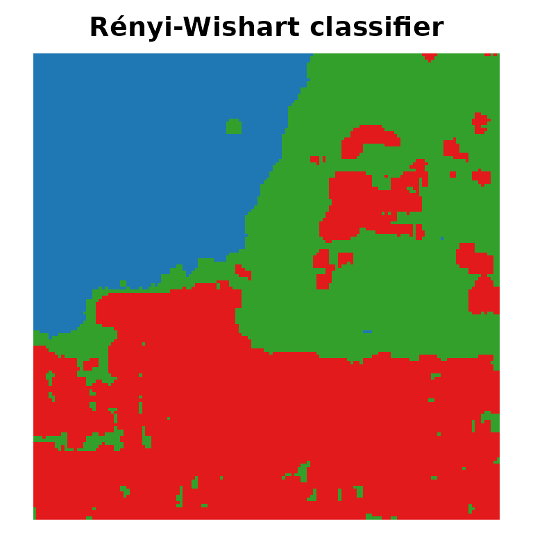

# Divergence-based classification with tidymodels

The divergence-based classifiers of Ferreira, Coelho and Nascimento
(2021) represent each pixel by the model fitted to its neighbourhood and
assign it to the class whose model is the closest according to a
divergence (Kullback-Leibler, Jeffreys, Bhattacharyya or Rényi).
`SITSAR` provides them as an R6 class (`DivergenceClassifier`) and as
the `parsnip` model
[`divergence_classifier()`](https://jodavid.github.io/SITSAR/reference/divergence_classifier.md),
so they plug into `tidymodels` workflows.

``` r

library(SITSAR)
library(parsnip)
library(recipes)
library(workflows)
library(rsample)
library(tune)
library(yardstick)
```

## Features

[`sar_features()`](https://jodavid.github.io/SITSAR/reference/sar_features.md)
computes the local statistics used by both engines: the Gaussian
features (`mean_*`, `cov_*`) and the complex Wishart features (`c11`,
`c12_re`, `c12_im`, …).

``` r

img <- SARImage$new(SanFrancisco150, looks = 4)
feats <- sar_features(img, window = 5)
feats$class <- factor(as.vector(SanFrancisco150_gt),
                      labels = c("ocean", "vegetation", "urban"))
dim(feats)
#> [1] 22500    21

set.seed(123)
split <- initial_split(feats, prop = 0.02, strata = class)
train <- training(split)
test <- testing(split)
nrow(train)
#> [1] 448
```

## A parsnip model

``` r

spec <- divergence_classifier(divergence = "renyi", order = 0.5, kind = 3) |>
  set_engine("wishart")
spec
#> Divergence Classifier Model Specification (classification)
#> 
#> Main Arguments:
#>   divergence = renyi
#>   order = 0.5
#>   kind = 3
#> 
#> Computational engine: wishart

rec <- recipe(class ~ ., data = train) |>
  update_role(row, col, new_role = "id")

wf <- workflow(rec, spec)
fitted <- fit(wf, data = train)
pred <- augment(fitted, test)
accuracy(pred, truth = class, estimate = .pred_class)
#> # A tibble: 1 × 3
#>   .metric  .estimator .estimate
#>   <chr>    <chr>          <dbl>
#> 1 accuracy multiclass     0.932
conf_mat(pred, truth = class, estimate = .pred_class)
#>             Truth
#> Prediction   ocean vegetation urban
#>   ocean       5802         88     0
#>   vegetation     7       6207  1385
#>   urban          0         10  8553
```

## Tuning the order of the Rényi divergence

``` r

spec_tune <- divergence_classifier(divergence = "renyi", order = tune()) |>
  set_engine("wishart")
set.seed(1)
folds <- vfold_cv(train, v = 3, strata = class)
res <- tune_grid(workflow(rec, spec_tune), resamples = folds,
                 grid = data.frame(order = c(0.1, 0.5, 0.9)),
                 metrics = metric_set(accuracy, kap))
collect_metrics(res)
#> # A tibble: 6 × 7
#>   order .metric  .estimator  mean     n std_err .config        
#>   <dbl> <chr>    <chr>      <dbl> <int>   <dbl> <chr>          
#> 1   0.1 accuracy multiclass 0.866     3 0.0182  pre0_mod1_post0
#> 2   0.1 kap      multiclass 0.798     3 0.0268  pre0_mod1_post0
#> 3   0.5 accuracy multiclass 0.926     3 0.00815 pre0_mod2_post0
#> 4   0.5 kap      multiclass 0.888     3 0.0123  pre0_mod2_post0
#> 5   0.9 accuracy multiclass 0.969     3 0.00427 pre0_mod3_post0
#> 6   0.9 kap      multiclass 0.952     3 0.00643 pre0_mod3_post0
best <- select_best(res, metric = "accuracy")
best
#> # A tibble: 1 × 2
#>   order .config        
#>   <dbl> <chr>          
#> 1   0.9 pre0_mod3_post0
```

## Classification map

``` r

final <- finalize_workflow(workflow(rec, spec_tune), best) |> fit(train)
map <- predict(final, feats)$.pred_class
plot_map(matrix(as.integer(map), 150), main = "Rényi-Wishart classifier",
         palette = c("#1f78b4", "#33a02c", "#e31a1c"))
```



``` r

kappa_statistics(SanFrancisco150_gt, matrix(as.integer(map), 150))
#> # A tibble: 1 × 5
#>   kappa   variance std_error overall_accuracy     n
#>   <dbl>      <dbl>     <dbl>            <dbl> <dbl>
#> 1 0.940 0.00000396   0.00199            0.961 22500
```

## Comparing Gaussian and Wishart features

``` r

grid <- expand.grid(engine = c("gaussian", "wishart"),
                    divergence = c("kl", "jeffreys", "bhattacharyya", "renyi"),
                    stringsAsFactors = FALSE)
grid$accuracy <- mapply(function(eng, dv) {
  f <- workflow(rec, divergence_classifier(divergence = dv) |> set_engine(eng)) |>
    fit(train)
  accuracy_vec(test$class, predict(f, test)$.pred_class)
}, grid$engine, grid$divergence)
grid
#>     engine    divergence  accuracy
#> 1 gaussian            kl 0.9330673
#> 2  wishart            kl 0.9610466
#> 3 gaussian      jeffreys 0.8204245
#> 4  wishart      jeffreys 0.9336568
#> 5 gaussian bhattacharyya 0.8162525
#> 6  wishart bhattacharyya 0.9324324
#> 7 gaussian         renyi 0.8162525
#> 8  wishart         renyi 0.9324324
```

## Reference

Ferreira, J. A., Coelho, H. and Nascimento, A. D. C. (2021). A family of
divergence-based classifiers for polarimetric synthetic aperture radar
(PolSAR) imagery vector and matrix features. *International Journal of
Remote Sensing*, 42(4), 1201–1229.
<https://doi.org/10.1080/01431161.2020.1826060>
